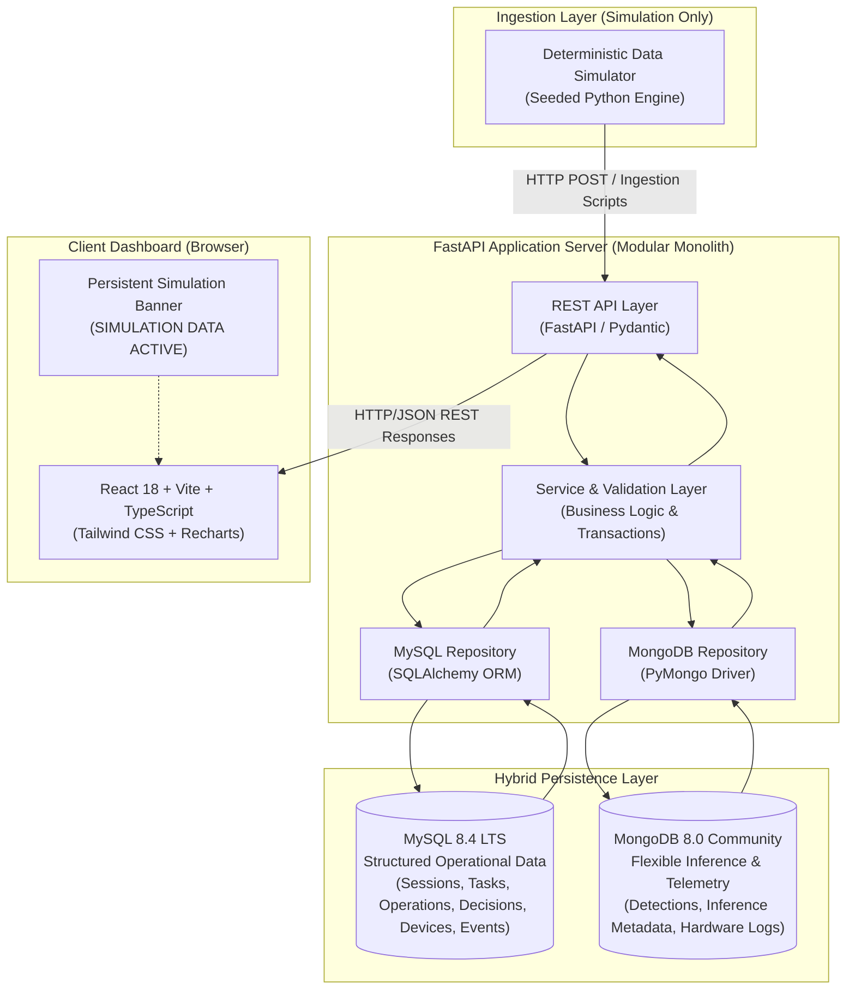

# System Architecture Specification

## 1. Multi-Tier Architecture Overview

The **Post-Harvest DBMS** is architectured as a modular monolith separating the simulated data ingestion, server-side persistence/API gateway, and browser-based presentation layer.

---

## 2. Component Descriptions

### 2.1 Ingestion Layer (`simulator/`)
- Generates reproducible, realistic operational cycles for post-harvest handling.
- Implements deterministic random distributions for confidence scores, cycle times, task priority distributions, and fault injections.
- Emits records with explicit provenance: `provenance = "SIMULATED"`.
- Kept strictly separate from the database schema definitions and browser UI.

### 2.2 Application Server Layer (`backend/app/`)
- Built with **FastAPI** running on Python 3.13+.
- **`app/api/`**: Exposes REST endpoints conforming strictly to `docs/api/API_CONTRACT.md`.
- **`app/schemas/`**: Pydantic models ensuring complete request payload validation and response serialization.
- **`app/services/`**: Coordinates transactions, cross-model lookups, and simulation management.
- **`app/repositories/`**: Isolates direct database queries. Encapsulates SQLAlchemy sessions and PyMongo collections.
- **`app/models/`**: Defines SQLAlchemy ORM mapped classes.

### 2.3 Persistence Layer (`database/`)
- **MySQL 8.4 LTS**: Authoritative store for structured relational records (sessions, tasks, decisions, operations, devices, and structured system events). Enforces 3NF constraints, foreign key integrity, and indexed lookups.
- **MongoDB Community Server 8.0**: Authoritative store for semi-structured vision detections, flexible model inference configurations, and raw telemetry streams.

### 2.4 Presentation Layer (`frontend/`)
- Built with **React 18**, **TypeScript**, and **Vite**, styled with **Tailwind CSS**.
- Employs **TanStack Query** for cached asynchronous HTTP queries and automatic UI re-fetching.
- Visualizes operational trends and metrics with **Recharts**.
- Displays an unclosable, persistent "SIMULATION DATA ACTIVE" banner across all pages.
- Maintains zero direct connectivity or credentials to MySQL or MongoDB.

---

## 3. Data Flow Alignment with DFD Specifications

1. **Level 0 Data Flow**:
   - Simulated Data Generator emits operational data, detections, and events to the DBMS.
   - The DBMS provides operational reports, aggregated metrics, and query results to the Operator/Dashboard.
2. **Level 1 Data Flow**:
   - Ingestion endpoints validate data (`Process 1.0: Collect & Validate Data`).
   - Validated operational records are persisted into `D1: MySQL Database` and flexible detection documents into `D2: MongoDB Database` (`Process 2.0: Manage Operational Records`).
   - Analytics and reporting endpoints query both databases to aggregate operational KPIs (`Process 3.0: Retrieve Data and Generate Reports`).

