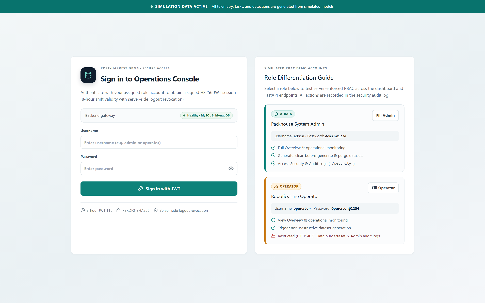
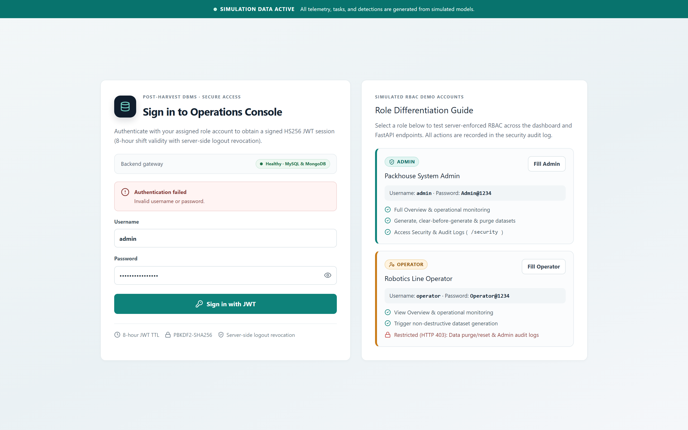
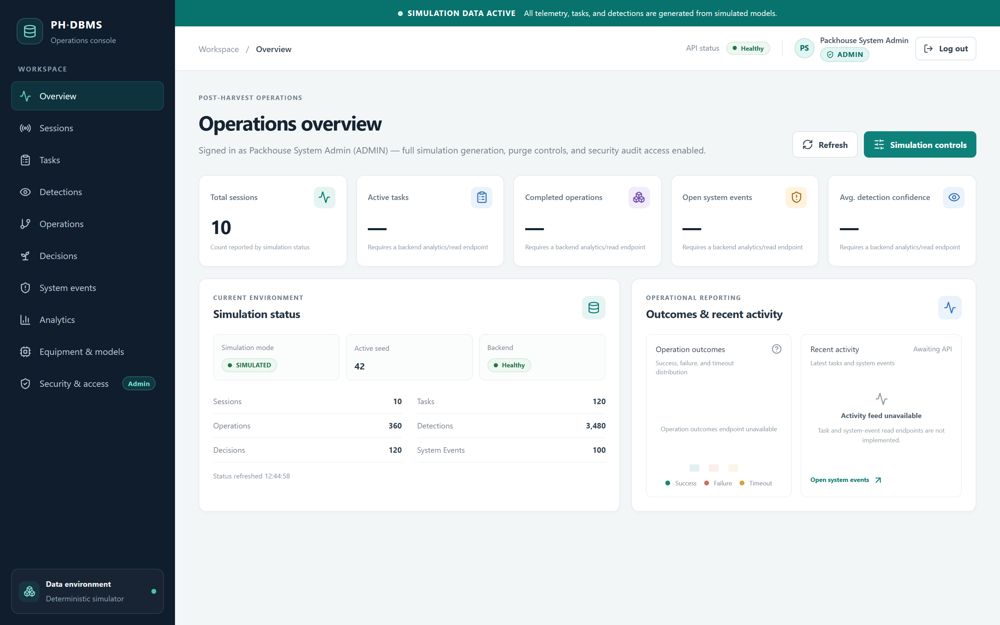
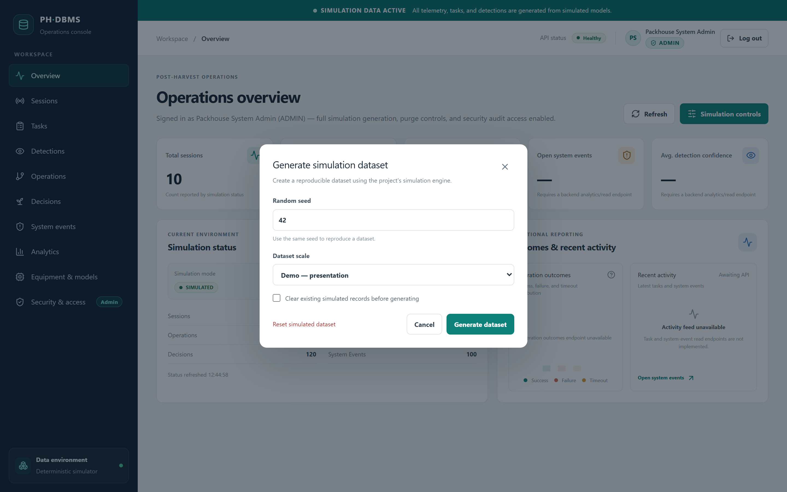
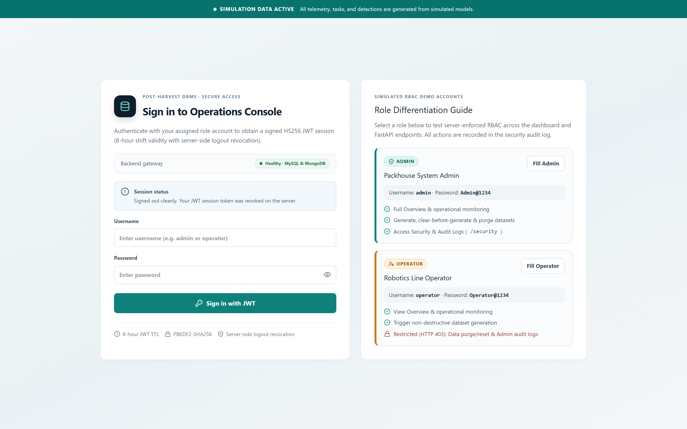
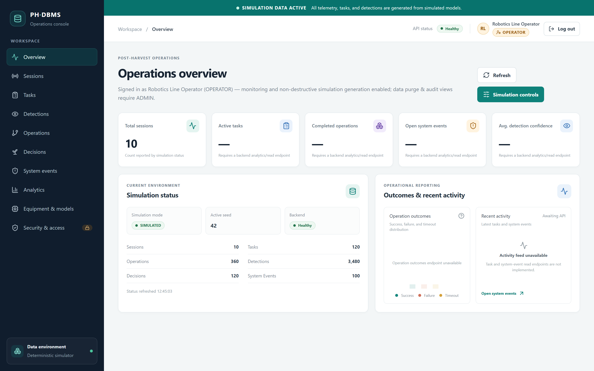
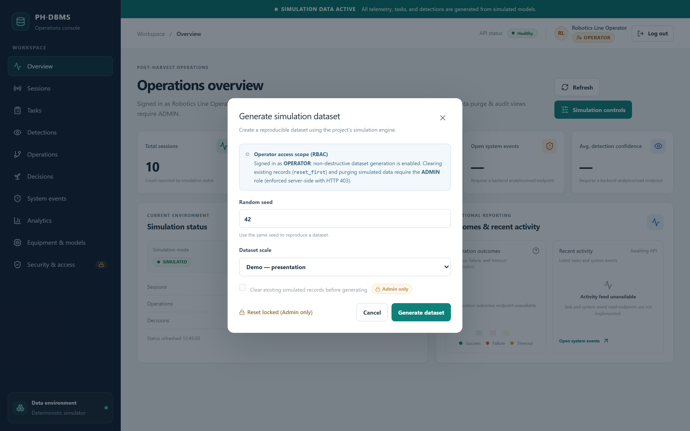
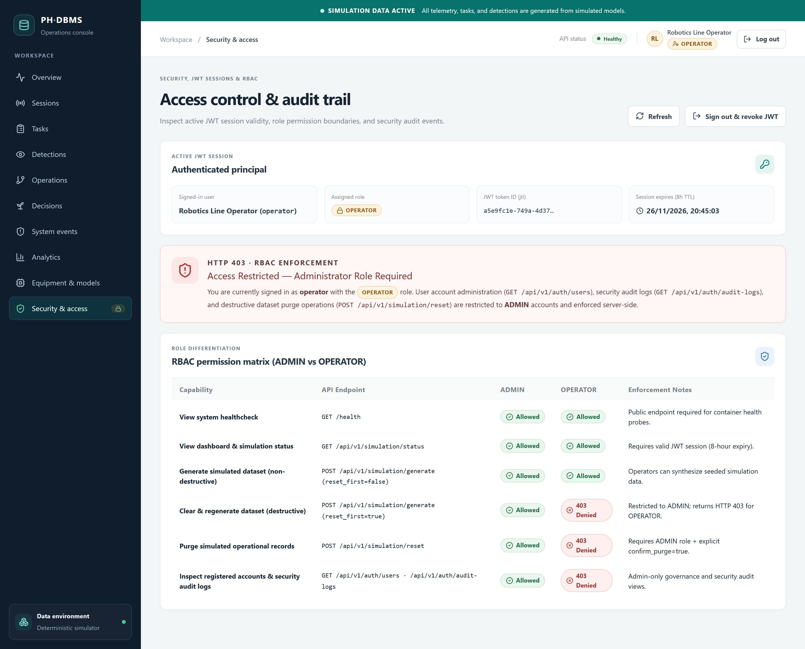
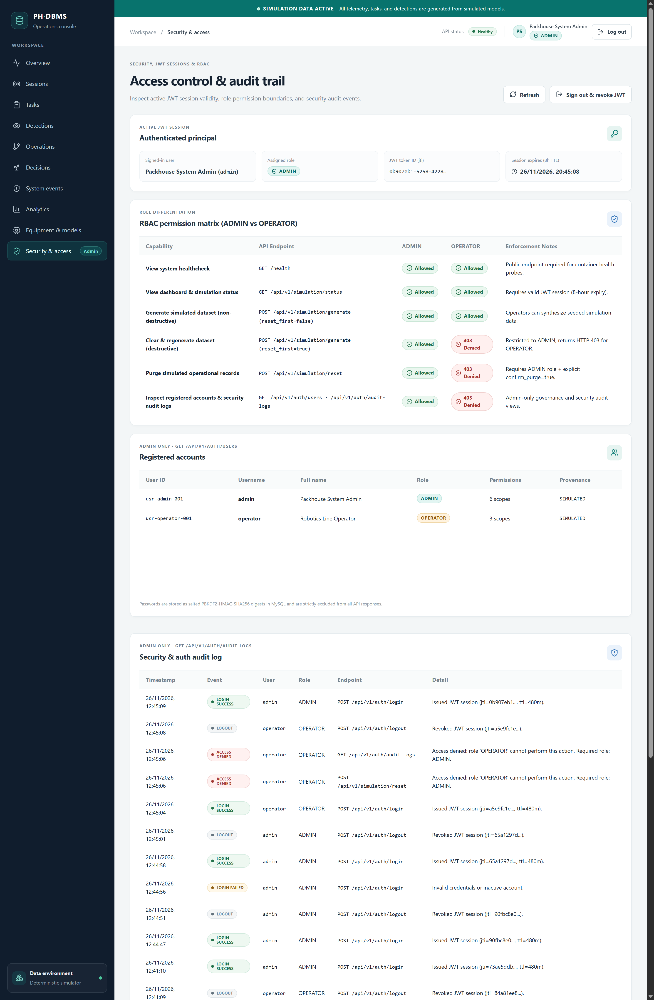
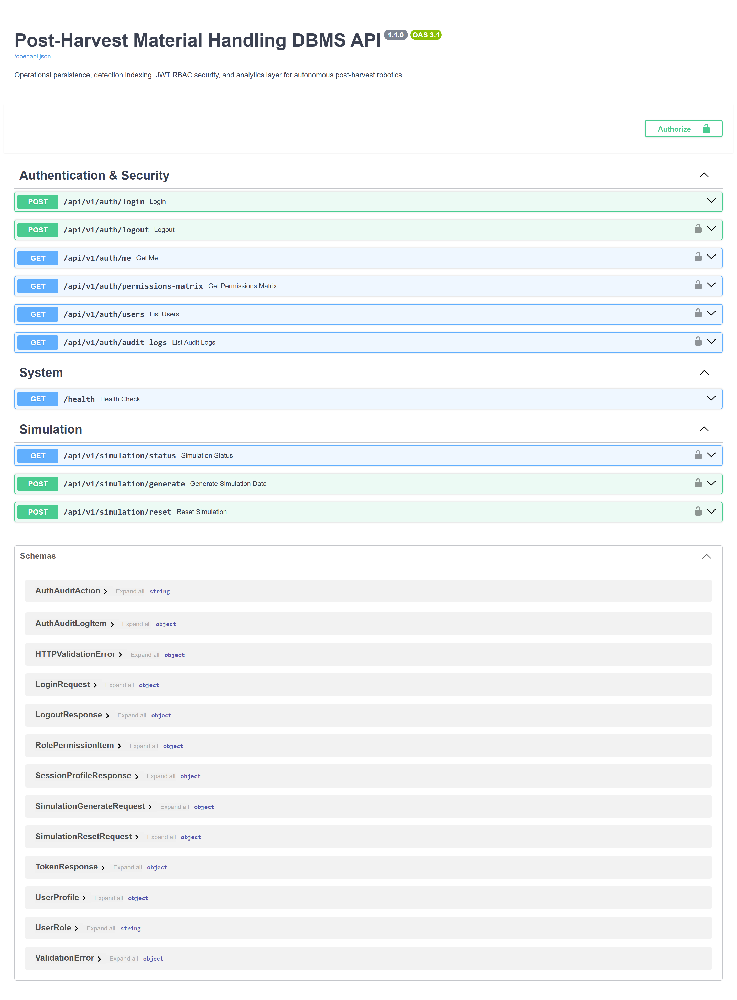

# Security, JWT Authentication, RBAC & Validation Proof Report

**Project**: Intelligent Data Management and Operational Analytics for Autonomous Post-Harvest Material Handling Systems  
**Architecture Decision**: `DEC-08` ([DECISION_LOG.md](../decisions/DECISION_LOG.md))  
**Date Verified**: 2026-11-26  
**Environment**: Docker Compose (`mysql:8.4`, `mongo:8.0`, FastAPI `v1.1.0`) + React/Vite (`http://localhost:5173`)  
**Provenance Notice**: All operational records and demo user accounts are explicitly tagged `provenance = "SIMULATED"`.

---

## 1. Security Architecture Summary

| Security Control | Implementation | Verification Evidence |
| :--- | :--- | :--- |
| **Authentication Scheme** | Signed `HS256` JWT (`PyJWT`) with `sub`, `username`, `role`, `jti`, `iat`, `exp` | `test_admin_and_operator_login_issue_valid_8h_jwt` |
| **Session Time Limit** | **8 hours (`480` minutes / `28,800s`)** configurable via `JWT_ACCESS_TOKEN_EXPIRE_MINUTES` | Verified in JWT `expires_in` & `/security` UI panel |
| **Server-Side Logout Revocation** | `POST /api/v1/auth/logout` writes `jti` into MySQL `revoked_token` table; replaying a logged-out JWT immediately returns `HTTP 401` | `test_logout_revokes_jwt_server_side` + live browser replay test |
| **Password Storage** | Salted **PBKDF2-HMAC-SHA256** (`600,000` iterations, unique 16-byte random salt, constant-time `hmac.compare_digest`); `password_hash` excluded from all API schemas | `test_password_hashing_uses_unique_salts_and_verifies` + `/api/v1/auth/users` schema |
| **Role-Based Access Control (RBAC)** | Server-enforced 2-role model: **`ADMIN`** vs **`OPERATOR`** via FastAPI dependencies (`get_current_user`, `require_roles`) | `test_rbac_role_differentiation_admin_vs_operator` + live `HTTP 403` tests |
| **Anti-Enumeration & Brute-Force Protection** | Generic `"Invalid username or password."` (`HTTP 401`) on both wrong password and unknown user; 5 failed logins within 5 min trigger `HTTP 429 Too Many Requests` | `test_invalid_credentials_do_not_enumerate_usernames`, `test_brute_force_rate_limit_triggers_429` |
| **Strict Input Validation & SQLi Defense** | Pydantic v2 `extra="forbid"`, username regex `^[a-zA-Z0-9_.-]+$`, bounded `seed` (`0..2147483647`), strict `scale` (`small`/`medium`/`demo`), parameterized SQLAlchemy ORM | `test_sql_injection_payload_safely_rejected`, `test_strict_input_validation_on_auth_and_simulation` |
| **Security Audit Trail** | MySQL `auth_audit_log` records `LOGIN_SUCCESS`, `LOGIN_FAILED`, `LOGOUT`, `ACCESS_DENIED`, and `RATE_LIMITED` events | Live `/security` audit table (`09_admin_security_audit_log.png`) |
| **Defensive HTTP Headers** | `X-Content-Type-Options: nosniff`, `X-Frame-Options: DENY`, `Referrer-Policy: strict-origin-when-cross-origin`, `Cache-Control: no-store` on `/api/v1/auth/*` | `test_security_headers_attached` |

---

## 2. Role Differentiation Matrix (`ADMIN` vs `OPERATOR`)

| Capability | Endpoint | Unauthenticated | `OPERATOR` | `ADMIN` |
| :--- | :--- | :---: | :---: | :---: |
| Healthcheck | `GET /health` | `200 OK` | `200 OK` | `200 OK` |
| Sign In | `POST /api/v1/auth/login` | `200` / `401` / `429` | — | — |
| Session Profile & Logout | `GET /api/v1/auth/me`, `POST /api/v1/auth/logout` | `401` | `200 OK` | `200 OK` |
| Dashboard & Simulation Status | `GET /api/v1/simulation/status` | `401` | `200 OK` | `200 OK` |
| Non-Destructive Dataset Generation | `POST /api/v1/simulation/generate` (`reset_first=false`) | `401` | `201 Created` | `201 Created` |
| Destructive Clear + Regenerate | `POST /api/v1/simulation/generate` (`reset_first=true`) | `401` | **`403 Forbidden`** | `201 Created` |
| Purge Simulated Records | `POST /api/v1/simulation/reset` | `401` | **`403 Forbidden`** | `200 OK` |
| User Registry & Security Audit Log | `GET /api/v1/auth/users`, `GET /api/v1/auth/audit-logs` | `401` | **`403 Forbidden`** | `200 OK` |

---

## 3. Automated Test Verification Results

### 3.1 Backend Test Suite (`docker compose exec -T backend pytest backend/tests -v`)
- **Result**: **26 / 26 PASSED** (exit code `0`)
- Security & validation tests verified (`backend/tests/test_auth_security.py`):
  1. `test_password_hashing_uses_unique_salts_and_verifies` — **PASSED**
  2. `test_admin_and_operator_login_issue_valid_8h_jwt` — **PASSED**
  3. `test_invalid_credentials_do_not_enumerate_usernames` — **PASSED**
  4. `test_sql_injection_payload_safely_rejected` — **PASSED**
  5. `test_unauthenticated_and_tampered_and_expired_tokens_rejected` — **PASSED**
  6. `test_logout_revokes_jwt_server_side` — **PASSED**
  7. `test_rbac_role_differentiation_admin_vs_operator` — **PASSED**
  8. `test_strict_input_validation_on_auth_and_simulation` — **PASSED**
  9. `test_brute_force_rate_limit_triggers_429` — **PASSED**
  10. `test_security_headers_attached` — **PASSED**
- Existing API, DB connector, ORM model, and deterministic simulator tests (16 tests) — **ALL PASSED**

### 3.2 Frontend Static & Build Verification (`frontend/`)
- `npm run lint` (`eslint .`): **PASSED** (0 errors, 0 warnings)
- `npm run build` (`tsc --noEmit && vite build`): **PASSED** (0 TypeScript errors, clean production bundle)

---

## 4. Visual Proofs (Live Application Screenshots)

All 10 screenshots below were captured directly from the live running application (`http://localhost:5173` & `http://localhost:8000/docs`) during end-to-end verification with zero uncaught browser runtime errors.

### 4.1 JWT Authentication Page & Demo Role Guide
Unauthenticated visits to `/` automatically redirect to `/login`. Displays the persistent `SIMULATION DATA ACTIVE` banner, live backend connectivity status, 8-hour JWT metadata, and the `ADMIN` vs `OPERATOR` role reference cards.

### 4.2 Invalid Credentials & Anti-Enumeration Validation (`HTTP 401`)
Submitting an invalid password returns a generic `"Invalid username or password."` alert (never revealing whether a username exists) and records a `LOGIN_FAILED` entry in `auth_audit_log`.

### 4.3 `ADMIN` Overview Dashboard
Authenticated as `admin` (`Packhouse System Admin`): displays the teal `ADMIN` badge, **Log out** button in the topbar, `Security & access [Admin]` sidebar entry, and live `demo` dataset counts (`10` sessions, `120` tasks, `360` operations, `3,480` detections).

### 4.4 `ADMIN` Simulation Controls (Full Generate, Clear & Purge Access)
`ADMIN` users have unrestricted access to **Clear existing simulated records before generating** (`reset_first=true`) and **Reset simulated dataset** (`POST /api/v1/simulation/reset`).

### 4.5 Logout & Server-Side JWT Revocation Proof
Clicking **Log out** calls `POST /api/v1/auth/logout`, inserts the token's `jti` into MySQL `revoked_token`, clears client storage, and redirects to `/login`. Replaying the revoked JWT against `GET /api/v1/auth/me` immediately returned **`HTTP 401 Unauthorized`**.

### 4.6 `OPERATOR` Overview Dashboard
Authenticated as `operator` (`Robotics Line Operator`): displays the amber `OPERATOR` badge, **Log out** button, locked indicator on `Security & access`, and operator scope summary.

### 4.7 `OPERATOR` Simulation Controls (Destructive Actions Locked)
Non-destructive dataset generation remains enabled for `OPERATOR`, while **Clear existing simulated records** (`Admin only`) and **Reset locked (Admin only)** are visibly locked in the UI and enforced server-side with `HTTP 403`.

### 4.8 `OPERATOR` RBAC Enforcement on `/security` (`HTTP 403`)
When an `OPERATOR` visits `/security`, the UI renders an explicit **HTTP 403 · Access Restricted — Administrator Role Required** panel alongside the live **RBAC Permission Matrix**. Direct API calls by `OPERATOR` to `POST /api/v1/simulation/reset` and `GET /api/v1/auth/audit-logs` both returned `HTTP 403 Forbidden` and were logged as `ACCESS_DENIED`.

### 4.9 `ADMIN` Security & Audit Trail (`/security`)
Authenticated as `ADMIN`, `/security` displays the active JWT session (`jti` and 8-hour expiry), full RBAC Permission Matrix, Registered Accounts (with zero password hashes exposed), and the live **Security & Auth Audit Log** showing real `LOGIN_SUCCESS`, `LOGIN_FAILED`, `LOGOUT`, and `ACCESS_DENIED` events recorded during this test run.

### 4.10 FastAPI Swagger UI with JWT Bearer Authentication (`/docs`)
OpenAPI `/docs` exposes the `Authorize` Bearer JWT scheme with lock icons on every protected auth and simulation endpoint while keeping `GET /health` and `POST /api/v1/auth/login` publicly accessible.

